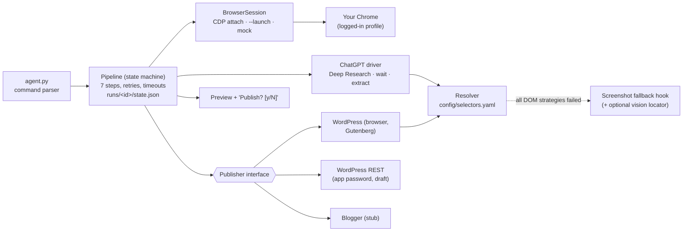

# Chrome Research-to-Blog Agent (Demo)

One command, run in **your own logged-in Chrome**:

```bash
python agent.py "research best SEO tools 2026 and post a blog"
```

1. opens ChatGPT (web) in your Chrome session
2. starts **Deep Research** on the topic
3. waits until the research is done (5-30 min, with live progress)
4. copies the full result (read from the DOM, no clipboard needed)
5. sends *"Turn this into a blog post"* and copies the blog
6. opens your blog editor (test WordPress) and pastes title + body into a **new draft**
7. stops, shows a preview and asks **`Publish? [y/N]`**. Nothing goes live unless you type `y`.

I built this as a small, well-tested demo of the hard parts: attaching to a real browser session, reliably detecting when a long Deep Research run is *really* finished, and making UI automation that's easy to fix when the UI changes.

```bash
pip install -r requirements.txt && playwright install chromium
python agent.py --dry-run "research best SEO tools 2026 and post a blog"   # no accounts needed
pytest                                                                      # 16 tests, headless
```

## Architecture



| Path | What it is |
|---|---|
| `agent.py` | CLI |
| `research_blog_agent/pipeline.py` | the 7-step resumable state machine |
| `research_blog_agent/chatgpt.py` | ChatGPT web driver (Deep Research toggle, send, extract, copy-button path) |
| `research_blog_agent/wait.py` | long-wait completion detector |
| `research_blog_agent/locate.py` | selector resolver (role/aria/test-id/text/css) |
| `research_blog_agent/fallback.py` | screenshot fallback hook + `VisionLocator` protocol |
| `research_blog_agent/publishers/` | `Publisher` interface, WordPress browser + REST, Blogger stub |
| `config/selectors.yaml` | **every** selector, in one file |
| `mock/` | fake chat page + fake block editor for `--dry-run` and tests |
| `scripts/start_chrome_debug.ps1` / `.sh` | start Chrome with remote debugging |

## Setup

Python 3.11+.

```bash
python -m venv .venv && . .venv/bin/activate        # Windows: .venv\Scripts\activate
pip install -r requirements.txt
playwright install chromium                          # only needed for --dry-run / tests
```

Start Chrome with remote debugging and log in to ChatGPT (and your test blog) once:

```powershell
# Windows
powershell -ExecutionPolicy Bypass -File scripts\start_chrome_debug.ps1
```
```bash
# macOS / Linux
./scripts/start_chrome_debug.sh
```

> Since Chrome 136, `--remote-debugging-port` is ignored for Chrome's *default* profile directory, so the script uses a dedicated profile folder. It's still your own Chrome with your own logins, and they persist between runs.

## Usage

```bash
# attach to the Chrome you started above (default, CDP on :9222)
python agent.py "research best SEO tools 2026 and post a blog" --wp-url https://test-blog.example.com

# or let the agent launch Chrome with a persistent profile
python agent.py --launch "research best SEO tools 2026 and post a blog"

# WordPress REST API instead of the editor UI (creates a draft)
export WP_USER=editor WP_APP_PASSWORD="xxxx xxxx xxxx xxxx"
python agent.py --platform wordpress-rest --wp-url https://test-blog.example.com "research ... and post a blog"

# resume an interrupted run (e.g. laptop slept during Deep Research)
python agent.py --resume runs/20261005-194432
```

Useful flags: `--max-wait-min 35`, `--extract copy` (use ChatGPT's Copy button + clipboard instead of the DOM), `--no-deep-research`, `--stop-after <step>`, `--selectors my.yaml`, `--headed` (watch the mock run).

Every run writes `runs/<id>/` with `state.json`, `run.log`, `research.md/.html`, `blog.md/.html` and failure screenshots.

## How the long wait works

Deep Research can take 5-30 minutes, can stream in bursts, and often asks clarifying questions first. A reply counts as **finished** only when all of these are true:

- a **new** assistant message exists (count above the baseline recorded before sending),
- **no busy indicator** is visible (stop button, "Researching…" status, all configured in YAML),
- the message text has been **unchanged for `stable_s`** (default 20 s, polled every 5 s),
- it's at least **`min_chars`** long, so a short "starting research…" note is never mistaken for the report.

If the idle reply is short and contains a question, the agent answers once with *"use your best judgment and proceed"* and keeps waiting. Progress prints every 30 s (`… Deep Research working: 12:30 elapsed, 0 chars so far`). The default maximum is **35 min**. On timeout the run state is kept and `--resume` reopens the same conversation URL, because Deep Research keeps running on the server. `tests/test_wait.py` simulates a 20-minute run with a clarification using a fake clock.

## Reliability

- **DOM/accessibility first.** Elements are found by role + accessible name, `data-testid`, label or text, and CSS only as a last resort. Text is read via `innerText`/`innerHTML` of the last assistant turn, so there's no clipboard race. The Copy button path is optional.
- **One selectors file.** `config/selectors.yaml` lists ordered strategies per element. When ChatGPT or WordPress changes its UI, the fix is usually one line, with no code change.
- **Screenshot fallback hook.** If every strategy fails, a screenshot is saved and an optional `VisionLocator` can return click coordinates (tested with a fake one). It ships disabled, so failures stay explicit and debuggable.
- **Steps are idempotent and resumable.** State is saved after every step, and "prompt sent" flags stop a retry from sending a prompt twice. Retries use backoff and a screenshot on each failure. Login walls fail fast with a clear message.
- **Real paste, verified.** The body goes into Gutenberg as a synthetic `paste` event carrying `text/html`, so the editor converts it into proper blocks. If that doesn't work it falls back to `wp.data` and then to typing. The draft is then read back (title + body length) to check it.
- **Tested headless end to end** against `mock/`, which copies the same DOM contract (test IDs, aria labels, message roles) as the real sites.

## Safety

- **It never auto-publishes.** It saves a draft, prints a preview and asks `Publish? [y/N]`. The default is No, and a non-interactive run always stays a draft.
- **It uses your own session.** It attaches to your Chrome and your logins, never touches your tabs, and only disconnects at the end.
- **No credentials are stored.** No passwords are typed or saved. The REST publisher reads `WP_USER` / `WP_APP_PASSWORD` from the environment, and they are never written to state or logs.
- Point it at a **test** blog first.

## How I'd help

I'm Mihai, a senior engineer. I can turn this into a Windows-ready tool before the deadline, tuned against your real ChatGPT/WordPress/Blogger accounts and packaged as a single executable or a callable module. I'd then extend it to the **ChatGPT desktop app** through Windows UI Automation (pywinauto), using the same "read the app first, screenshot only as a fallback" approach, and wire it into your **voice command layer** so a spoken request maps onto this pipeline with a spoken "Publish?" confirmation.

## License

MIT
